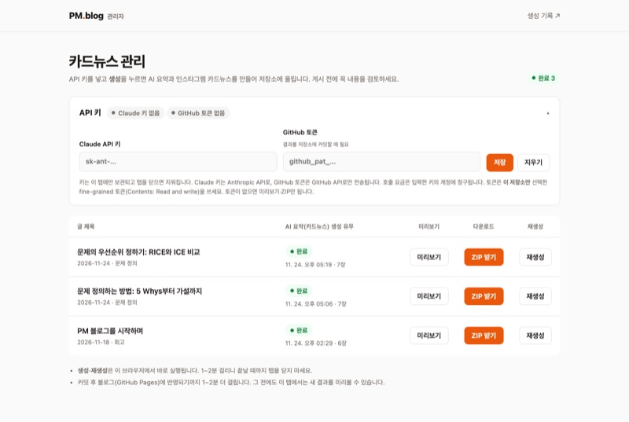
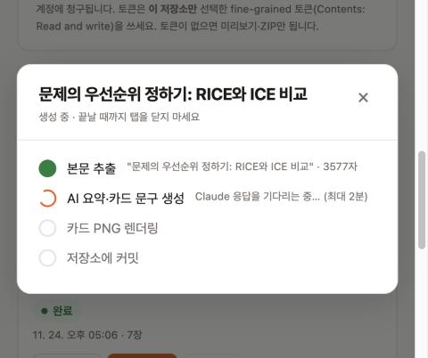
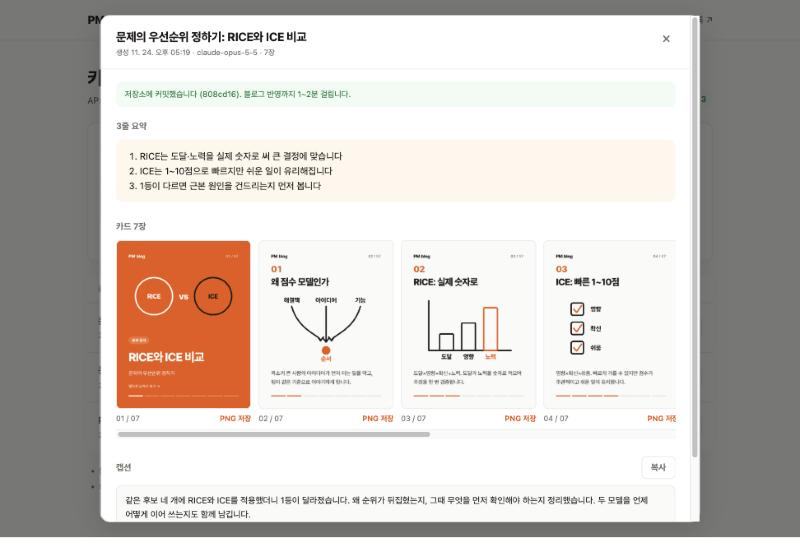
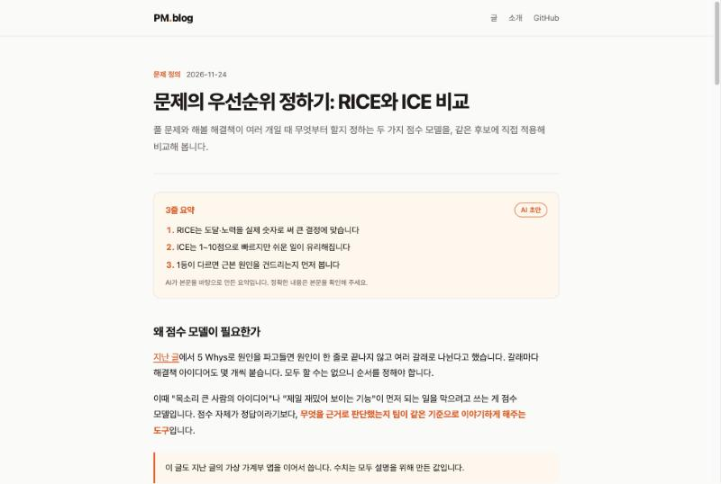

# 미니프로젝트 결과 보고서 — 블로그 글 AI 요약 · 카드뉴스 원클릭 생성

- **작성일**: 2026-11-25 · **작성자**: 김승엽 / AIPM 실습
- **수행 기간**: 2026-11-23(월) 아이디에이션 → 11-24(화) ~ 11-25(수) 구현·테스트
- **배포 블로그**: https://summer-kim626.github.io/PM-blog/ (관리자 페이지: `/admin/`)
- **GitHub 저장소**: https://github.com/summer-kim626/PM-blog
- **제출 문서**: [PRD](./PRD.md) · [테스트 보고서](./test-report.md) · [에이전트 지침](../agent/AGENTS.md) · [의사결정 로그](../logs/decision-log.md) · [성공/실패 로그](../logs/success-failure.md)

---

## 1. 한 줄 요약

관리자가 `/admin`에서 글의 **[생성]** 버튼을 한 번 누르면, 브라우저가 글 본문을 추출해 **Claude Opus 5.5로 3줄 요약·인스타그램 카드뉴스(1080×1350, 5~7장)·캡션·해시태그**를 만들고, PNG로 그린 뒤 GitHub 저장소에 커밋한다. 글 1편 기준 **약 39초**에 끝난다.

## 2. 문제 정의

> 1인 블로그 운영자는 글을 쓴 뒤 홍보용 카드뉴스를 따로 만들 시간이 없어, 글을 올려도 SNS 홍보를 건너뛰고 유입 기회를 놓친다.

| 구분 | 내용 |
| --- | --- |
| ASIS | 글 1편마다 요약 → Canva 카드 제작 → 캡션 작성에 **추가 1시간 이상**. 그래서 홍보를 자주 건너뜀 |
| 1순위 타깃 | 관리자(나) — 주 1~2회 PM 학습 글을 쓰는 취업 준비생 |
| 2순위 타깃 | 독자 — 모바일로 PM 콘텐츠를 훑어보는 주니어 기획자 (긴 글의 핵심을 빨리 파악하고 싶음) |
| 목표(TOBE) | "글쓰기 → 홍보" 사이의 손작업을 없앤다 |

## 3. 구현 결과

### 3.1 기능

| ID | 기능 | 구현 내용 | 결과 |
| --- | --- | --- | --- |
| F1 | 생성 실행 | `/admin` 글별 [생성]·[재생성] 버튼, 4단계 진행 표시 | ✅ 약 39초 (기준 3분) |
| F2 | 본문 추출 | 글 HTML의 `<article>`에서 제목·본문만 추출, GTM·메뉴 제거 | ✅ |
| F3 | AI 생성 | Claude Opus 5.5 + JSON 스키마 구조화 출력, 과부하 시 Sonnet 5.5로 1회 대체 | ✅ |
| F4 | 카드 렌더링 | HTML 템플릿 1장 + 도형 14종 → html-to-image로 PNG 캡처 | ✅ 1080×1350 |
| F5 | 결과 저장 | GitHub Git Data API로 PNG·`summary.json`·상태를 커밋 1개로 저장 | ✅ |
| F6 | 글 상단 요약 | 독자용 3줄 요약 박스 + "AI 초안" 배지 | ✅ 배포본 확인 |
| F7 | 관리자 페이지 | 글별 상태·미리보기·ZIP 다운로드·생성, 인증 번호 화면 | ✅ |

**유저 플로우:** 홈 사이드바 [관리자] → 인증 번호 → API 키 입력 → [생성] → 진행 단계 확인 → 미리보기 검토 → ZIP(PNG + 캡션) 다운로드 → 인스타그램에 직접 업로드

<table><tr>
<td> 관리자 페이지</td>
<td> 생성 진행</td>
<td> 결과 미리보기</td>
<td> 글 상단 AI 요약</td>
</tr></table>

### 3.2 기술 구성

| 영역 | 사용 기술 |
| --- | --- |
| 블로그 | 정적 HTML + Tailwind CSS, GitHub Pages 배포 |
| AI | Anthropic 공식 SDK `@anthropic-ai/sdk` 1.7.0 (`claude-opus-5-5`, 대체 `claude-sonnet-5-5`), 구조화 출력, `effort: low` |
| 데이터 처리 | 글 HTML 파싱·정제(`scripts/cardnews/parse.mjs`), AI 출력 검증(`validate.mjs`) |
| 렌더링 | 브라우저 html-to-image, 로컬 Node는 playwright-core + 헤드리스 Chrome |
| 저장·배포 | GitHub API 커밋 → GitHub Pages 자동 반영 |
| 보안 | 키는 그 탭의 `sessionStorage`에만, CSP로 전송처를 Anthropic·GitHub API로 제한, 외부 스크립트 SRI, fine-grained 토큰 |
| 개발 도구 | Claude Code + `AGENTS.md` 에이전트 지침 (루트 `CLAUDE.md`가 자동 로드) |

규모: 소스 약 2,000줄 (관리자 페이지 905줄, 카드 템플릿·도형 413줄, 생성 스크립트 589줄, 요약 스크립트 62줄), 단위 테스트 23개.

### 3.3 실제 생성 결과

블로그 글 3편 모두 카드뉴스가 `완료` 상태다 (`data/cardnews/index.json`).

| 글 | 카드 | 경고 |
| --- | --- | --- |
| 2026-11-18-start-pm-blog | 6장 | 0 |
| 2026-11-24-problem-definition | 7장 | 0 |
| 2026-11-24-rice-vs-ice | 7장 | 0 |

"RICE·ICE 비교" 글로 본 생성 품질: 본문에 없는 사실·수치 **0건**, 카드 도형 6종이 겹치지 않음, 합니다체 유지, 해시태그 8개.

## 4. 교과목 학습 내용과의 연결

| 과제 요구 / 학습 내용 | 이 프로젝트에서 적용한 것 |
| --- | --- |
| 데이터 수집·전처리 | 블로그 HTML에서 `<article>` 본문만 추출하고 스크립트·메뉴·빈 줄을 정리, 소제목·목록 구조는 유지 (F2) |
| AI API 호출 구조 설계 | 공용 모듈(`parse`·`ai`·`validate`)을 Node와 브라우저가 함께 쓰는 구조, 최대 2회 호출·대체 모델 규칙 |
| Prompt Engineering | System Prompt에 "본문에 없는 사실 금지"·글자 수·카드 구성·말투 규칙, JSON 스키마로 출력 형식 강제 |
| LLM API Integration | Gemini REST → Claude 공식 SDK로 교체, 과부하(529)·거절(refusal)·키 오류 처리 |
| Tool/구조화 출력 | AI가 SVG를 직접 그리지 않고 정해진 도형 14종에서 이름·라벨만 고르게 함 (D-006) |
| Frontend (Tailwind) | 블로그 `:root` 색 토큰을 카드·관리자 페이지·요약 박스에 그대로 사용 |
| Deployment | GitHub Pages 배포, GitHub Actions(날씨 봇·초기 카드뉴스 워크플로우) |
| Git & GitHub | `타입: 내용` 커밋 컨벤션, 작업 단위별 커밋 약 80개, PRD·테스트 보고서 버전을 커밋 메시지에 기록 |
| AI 에이전트 활용 | `AGENTS.md`로 구조·생성 규칙·보안·Git 규칙을 정해 Claude Code가 매 세션 같은 규칙으로 작업 |

**다루지 못한 부분:** 외부 사이트 웹 크롤링과 EDA(탐색적 데이터 분석) 시각화는 이번 범위에 넣지 않았다. 데이터 원천이 내 블로그 글 3편이라 분석할 양이 적었다. RAG·Multi-Agent도 쓰지 않았다(글 1편 단위 요약이라 검색 단계가 필요 없었음).

## 5. 진행 과정과 주요 의사결정

| 시점 | 결정 | 이유 |
| --- | --- | --- |
| 11/24 오전 | 주제: 관리자용 카드뉴스 자동 생성 (D-001) | 독자용 Q&A 챗봇보다 "워크플로우 자동화" 목표에 맞고 이틀 안에 출시 가능 |
| 11/24 오전 | 인스타그램 자동 업로드 제외 (D-003) | 비즈니스 계정·API 심사가 필요해 기한 내 불가. 핵심 문제는 생성 자동화로 해결 |
| 11/24 오후 | 카드 = HTML 템플릿 1장 + 도형 목록 (D-005·006) | AI 출력이 바로 입력이 되고, 스타일이 항상 같으며 깨지지 않음 |
| 11/24 오후 | 대체 모델 추가 (D-012) | Gemini 무료 등급 503 과부하로 Actions 실행 실패 |
| 11/24 저녁 | AI 호출을 Actions → 관리자 브라우저로 이동 (D-014) | 재생성할 때마다 Actions 화면에서 slug를 붙여넣고 몇 분 기다려야 했음 |
| 11/24 저녁 | 모델을 Gemini → Claude로 변경 (D-015) | 과부하로 인한 실패가 잦아 안정성 확보 |
| 11/25 오전 | 사이드바 관리자 링크 + 인증 번호 (D-016) | 주소를 외우지 않고 들어가되 아무나 보지 않게. 정적 페이지 한계는 문서에 명시 |

결정 16건 전체는 [의사결정 로그](../logs/decision-log.md)에 선택지·이유·영향과 함께 남겼다.

## 6. 트러블슈팅 (성공/실패 로그 요약)

| 문제 | 원인 | 해결 |
| --- | --- | --- |
| Gemini 호출 402 | 키를 만든 Google 프로젝트가 선불 결제 프로젝트라 무료 등급 미적용 | 결제 미연결 계정에서 새 키 발급 |
| Gemini 503·응답 4분 이상 | 무료 등급 과부하, 기본 추론(thinking) 지연 | 시간 제한 120초·대체 모델·`thinkingLevel: low` → 최종적으로 Claude로 교체 |
| 실패 메시지에 내 PC 절대 경로 노출 | 오류 메시지를 그대로 공개 저장소에 커밋 | 저장소 기준 상대 경로만 남기도록 수정 |
| 재생성 버튼 클릭 시 slug 확인 불가 | 클립보드 실패 처리·팝업 차단 | 일반 링크로 바꾸고 실패 시 slug를 문구에 표시 |
| 커밋 단계 실패 | 클래식 토큰 사용 | Fine-grained 토큰(이 저장소, Contents 쓰기)으로 재발급 |

실패한 시도 11건을 지우지 않고 원인과 다음 행동까지 기록했다.

## 7. 테스트 결과

- **단위 테스트 23/23 통과** (`node --test mini-project-01/tests/`, 약 0.6초, 네트워크 없이 모의 응답 사용)
- **실제 생성(E2E):** 미생성 글에서 [생성] → 4단계 완료 약 39초, PNG 7장, 커밋 1개
- **배포본:** GitHub Pages에서 글 상단 3줄 요약·"AI 초안" 배지, 관리자 표·ZIP 확인
- **미확인:** 실제 529·거절 상황(단위 테스트로만 확인), 다크 모드, 원인 불명 콘솔 404 1건(기능 영향 없음)

자세한 내용은 [테스트 보고서](./test-report.md).

## 8. 성공 기준(OKR) 달성 현황

| KR | 목표 | 현재 | 비고 |
| --- | --- | --- | --- |
| KR1 | 홍보 콘텐츠 제작 60분 → 10분 이하 | 생성 자체는 약 39초 | 검토·업로드 준비까지 포함한 시간은 아직 직접 측정 전 |
| KR2 | 발행 글 중 카드뉴스 `완료`·`경고` 비율 100% | **3/3 (100%)** | `index.json` 기준 달성 |
| KR3 | 문구 수정 1회 이하로 쓴 카드뉴스 70% 이상 | 측정 전 | 실제 인스타그램 게시 후 기록 필요 |

## 9. 한계와 향후 계획

- **보안 한계:** 인증 번호는 정적 페이지의 화면 가림용이다. 실제 생성·커밋은 관리자의 API 키·토큰이 막는다.
- **자동성:** 키를 서버에 두지 않기로 하면서 "새 글 푸시 시 자동 생성"이 빠졌다. 관리자가 [생성]을 눌러야 한다.
- **검증 부족:** 문제 검증 설문(PRD 3.4)과 KR1·KR3 측정이 남아 있다. 실제 인스타그램 게시 후 수정 장 수·소요 시간을 기록한다.
- **다음 단계:** 카드 테마 선택, AI 호출 없이 PNG만 다시 그리기(Could), GTM `ai_summary_view`로 독자 요약 효과 측정, 데이터가 쌓이면 게시 성과 EDA.

## 10. 회고

- **잘한 점:** 기획 → 디자인 → 개발 → 테스트 → 배포를 이틀 안에 한 흐름으로 끝냈다. 결정과 실패를 매번 로그로 남겨, 방향을 바꿀 때(Actions → 브라우저, Gemini → Claude) 이유와 영향이 분명했다.
- **배운 점:**
  - GitHub 토큰 발급을 처음 해봤는데, 저장소마다 따로 발급받을 수 있고 권한도 따로 설정할 수 있다.
  - "무료 모델"이어도 결제 설정·과부하 같은 외부 조건에 따라 서비스가 멈춘다. 대체 경로와 실패 기록은 처음부터 설계해야 한다.
  - AI에게 자유롭게 그리게 하기보다 **선택지(도형 목록·JSON 스키마)를 주고 고르게 하면** 결과가 안정적이다.
  - 에이전트 지침(`AGENTS.md`)을 먼저 정해두니 AI가 만든 코드도 같은 규칙·커밋 형식을 지켜 관리하기 쉬웠다.
- **아쉬운 점:** 과제 요구 중 웹 크롤링·EDA 시각화를 넣지 못했고, 사용자 검증(설문·실사용 측정) 없이 구현을 먼저 진행했다.
