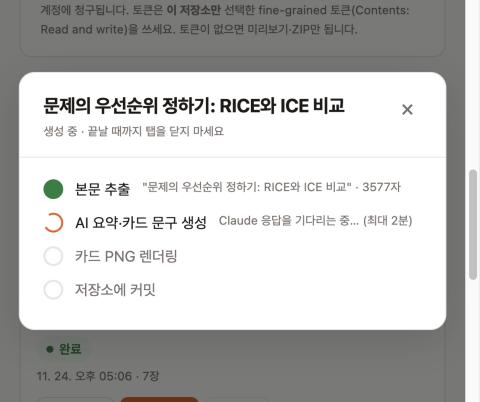
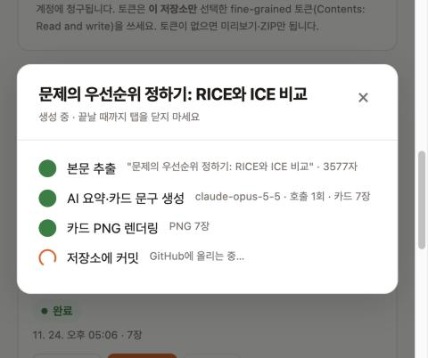
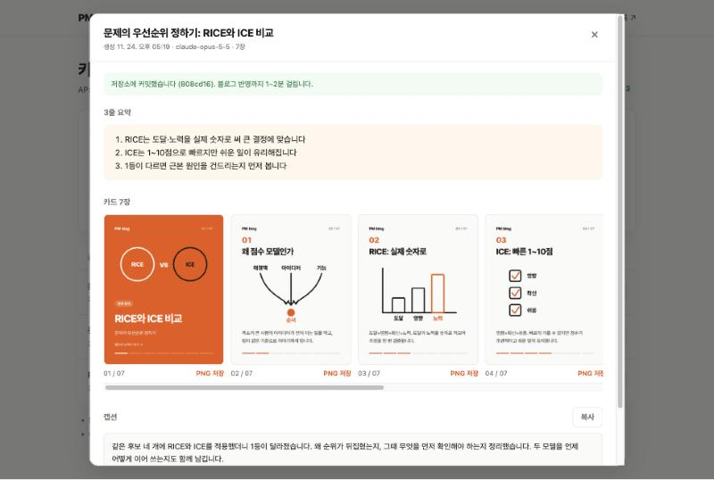
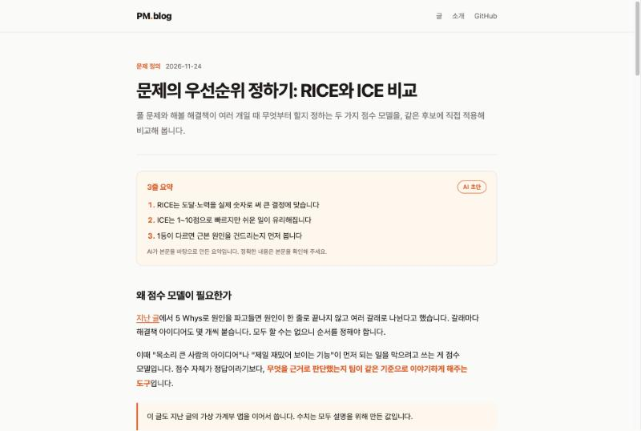

# 테스트 보고서

- **문서 버전**: v0.7 (실제 Claude 키·GitHub 토큰으로 생성 테스트, 기능별 단위 테스트 추가)
- **작성일**: 2026-11-24 · **기준**: [PRD](./PRD.md) 4.2 기능별 완료 기준
- **환경**: macOS, Node 26, Claude 데스크톱 앱 내장 브라우저, 로컬 HTTP 서버(`localhost:8000`)
- **대상 글**: `posts/2026-11-24-rice-vs-ice.html` (미생성 상태에서 처음 생성)
- **이전 결과**: 모의 응답으로 시험한 v0.6은 git 기록에 있음

## 요약

| ID | 기능 | 단위 테스트 | 실제 실행(E2E) | 결과 |
| --- | --- | --- | --- | --- |
| F1 | 생성 실행 | — | 4단계 완료 **약 39초** (기준 3분) | ✅ 통과 |
| F2 | 본문 추출 | 5/5 | 3,577자 추출 | ✅ 통과 |
| F3 | AI 생성 | 12/12 | `claude-opus-5-5`, 호출 1회, 경고 0건 | ✅ 통과 |
| F4 | 카드 렌더링 | (F5-3에서 크기 확인) | PNG 7장, 1080×1350 | ✅ 통과 |
| F5 | 결과 저장 | 3/3 | 커밋 `808cd16` 1개 (PNG 7 + `summary.json` + `index.json`) | ✅ 통과 |
| F6 | 글 상단 요약 | 2/2 | 3줄 요약 + "AI 초안" 배지 표시 | ✅ 통과 |
| F7 | 관리자 페이지 | 1/1 | 상태 "완료 3", ZIP 8개 파일 | ✅ 통과 |

**단위 테스트 23/23 통과** (0.5초, 네트워크 없음) · 실행: `node --test mini-project-01/tests/`

## 1. 실제 생성 테스트 (F1·F3·F4·F5)

**방법:** 내장 브라우저에서 `/admin/`을 열고 관리자가 Claude 키·GitHub 토큰을 입력한 뒤, 미생성 글의 [생성]을 눌렀다.

| 단계 | 화면 표시 | 결과 |
| --- | --- | --- |
| ① 본문 추출 | "문제의 우선순위 정하기: RICE와 ICE 비교" · 3577자 | ✅ |
| ② AI 요약·카드 문구 | `claude-opus-5-5` · 호출 1회 · 카드 7장 | ✅ 대체 모델 미사용 |
| ③ 카드 PNG 렌더링 | PNG 7장 | ✅ 넘침 경고 0건 |
| ④ 저장소에 커밋 | "저장소에 커밋했습니다 (808cd16)" | ✅ `chore(cardnews): 2026-11-24-rice-vs-ice 카드뉴스 생성` |

**생성 품질 (사람이 확인):** 본문과 대조했을 때 **본문에 없는 사실·수치는 0건**이었다(후보 4개·실수 5가지·"ICE로 거르고 RICE로" 모두 본문에 있음). 카드 구성은 cover 1 + point 5 + cta 1이다. 도형은 versus·converge·chart·checklist·magnifier·steps로 겹치지 않았고, 해시태그는 8개다. 말투는 합니다체를 지켰다.

<table><tr>
<td> ① 생성 진행 (AI 단계)</td>
<td> ② 커밋 단계</td>
</tr><tr>
<td> ③ 결과 미리보기 (요약·카드·캡션)</td>
<td> ④ 글 상단 AI 3줄 요약 (F6)</td>
</tr></table>

## 2. 기능별 단위 테스트

파일: [`mini-project-01/tests/unit.test.mjs`](../tests/unit.test.mjs). Claude 호출은 `fetch`를 가로채 모의 응답으로 대신했다.

| ID | 테스트 | 기대값 | 결과 |
| --- | --- | --- | --- |
| F2-1 | 글에서 제목·카테고리·본문 추출 | slug·title·cat 채워짐, 본문 50자 이상 | ✅ |
| F2-2 | 불필요한 문자열 제외 | GTM·`dataLayer`·"목록으로" 없음 | ✅ |
| F2-3 | 구조 유지 | 소제목 `## `, 목록 `- ` | ✅ |
| F2-4 | 잘못된 입력 | 파일명 형식·`<article>` 없음 → 오류 | ✅ |
| F2-5 | 목록에 없는 글 | 카테고리 빈 값 | ✅ |
| F3-1 | `sample.json` 검증 | 오류·경고 0 | ✅ |
| F3-2~3 | 카드 장수·순서 | 3장 → "5~7장" 오류, 순서 뒤집힘 → cover·cta 오류 | ✅ |
| F3-4~5 | 모르는 도형·글자 수 초과 | 실패가 아닌 경고 (도형은 제거) | ✅ |
| F3-6 | 해시태그 보정 | `PM` → `#PM`, 공백 제거 | ✅ |
| F3-7 | 키 없음 | 호출 0회, `NO_KEY` 오류 | ✅ |
| F3-8 | 요청 형식 | `claude-opus-5-5`, `effort: low`, JSON 스키마, `fallbacks: default`, temperature 없음 | ✅ |
| F3-9 | 529 과부하 | 2회차 `claude-sonnet-5-5`, `model`에 기록 | ✅ |
| F3-10~11 | 401 키 오류·`refusal` | 1회 호출 후 실패 처리 | ✅ |
| F3-12 | 형식 오류 응답 | 같은 모델로 1회 재시도 후 실패 (최대 2회) | ✅ |
| F5-1 | `index.json` | status ∈ done·warning·failed, 필수 필드 있음 | ✅ |
| F5-2 | 상태와 파일 일치 | PNG 장수 = `cards`, `summary.json` 검증 통과 (글 3편) | ✅ |
| F5-3 | PNG 크기 | 전 장 1080×1350 (20장) | ✅ |
| F6-1~2 | 글 상단 요약 | 모든 글이 `ai-summary.js` 로드, 응답 실패 시 그리지 않음, "AI 초안" 표기 | ✅ |
| F7-1 | 관리자 보안 | CSP `connect-src`는 Anthropic·GitHub API만, `localStorage` 저장 없음, `noindex` | ✅ |

## 3. 관리자 페이지 확인 (F7)

| 확인 항목 | 기대값 | 결과 |
| --- | --- | --- |
| 생성 후 목록 | 새 글 "완료 · 7장", 상단 "완료 3" | ✅ |
| ZIP 다운로드 | `2026-11-24-rice-vs-ice-cardnews.zip` = `card-01~07.png` + `caption.txt` | ✅ (페이지 안에서 압축을 다시 열어 확인) |
| 키 보관 | 탭을 닫으면 키가 사라짐 (sessionStorage) | ✅ 패널을 닫았다 열자 "키 없음"으로 돌아감 |

## 4. 발견 사항 · 미확인

- **콘솔 404 1건:** 원인이 된 요청을 특정하지 못했다. 생성·미리보기·ZIP에는 영향이 없었다.
- **미확인:** GitHub Pages 배포본에 반영됐는지(커밋 후 1~2분 소요), 다크 모드 화면, 실제 529·거절 상황(단위 테스트로만 확인).
